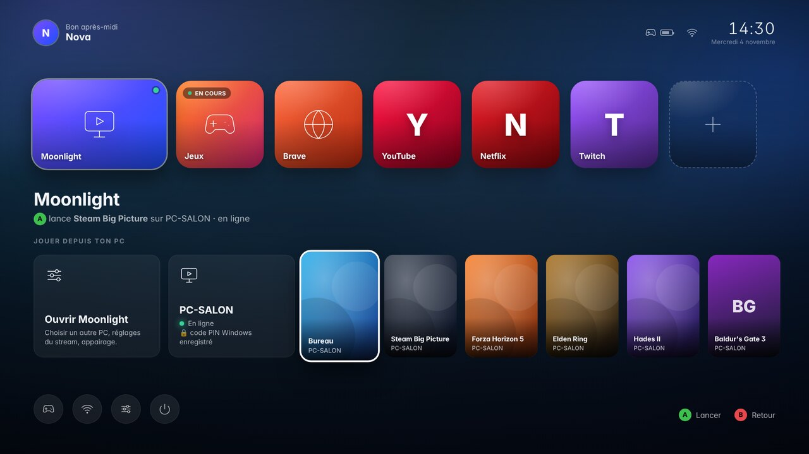
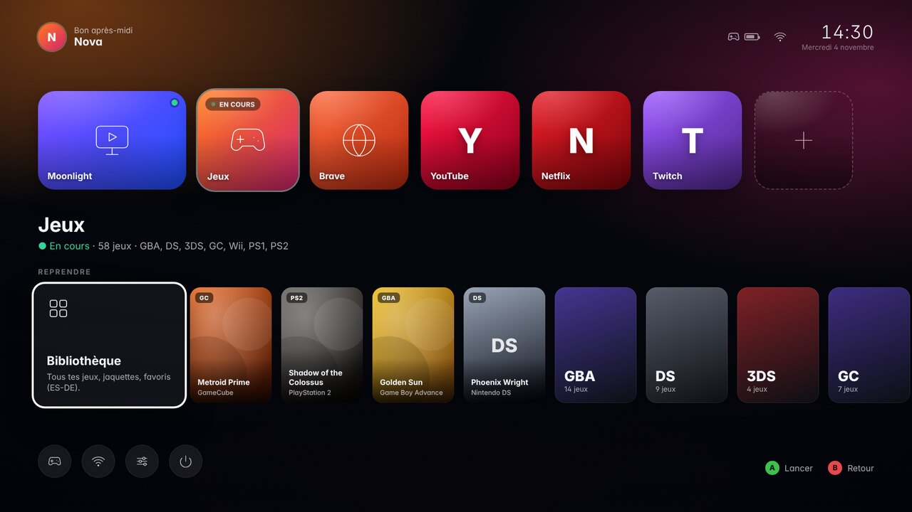
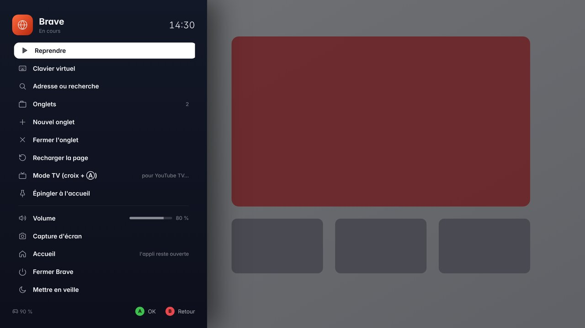
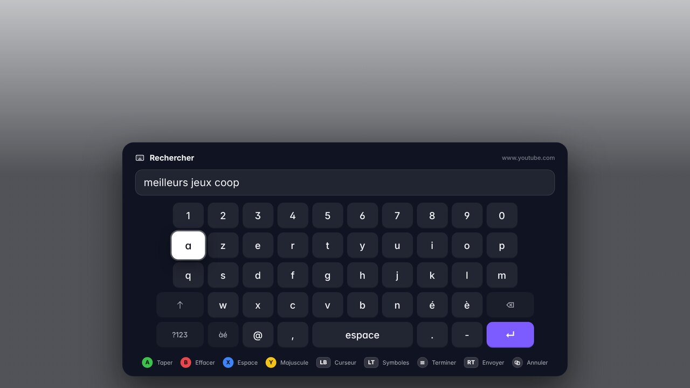
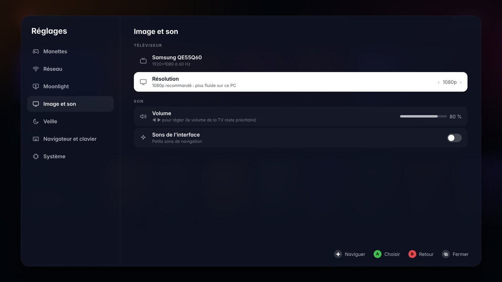

# Console UX481 — un Zenbook Duo devenu console de salon

Un ensemble de scripts qui transforme une **Debian 13 fraîchement installée** sur un
**Asus Zenbook Duo UX481** en console de salon : branchée en HDMI à la TV, capot fermé,
pilotée uniquement à la **manette Xbox**, réveillée en allumant la manette.



- **Écran d'accueil maison**, rapide et sobre : tuiles *Moonlight*, *Jeux*, *Brave*, tes
  sites épinglés et une tuile « + » pour en ajouter. Sous chaque tuile, une étagère
  contextuelle : les applis de ton PC (avec jaquettes) pour Moonlight, tes derniers jeux
  pour l'émulation, des suggestions de sites…
- **Moonlight au centre** : un clic sur un jeu de ton PC lance le stream directement, PC
  réveillé automatiquement (Wake-on-LAN) s'il dort.
- **Émulation** GBA, DS, 3DS, GameCube, Wii, PS1, PS2 via **ES-DE** (bibliothèque avec
  jaquettes) et des émulateurs préréglés pour la manette et la TV.
- **Brave à la manette** : stick gauche = pointeur, clavier virtuel qui s'ouvre tout seul
  dans les champs de texte, épinglage de n'importe quelle page sur l'accueil, mode « TV ».
- **Bouton Xbox = menu de la console** partout : reprendre, sauvegarder/charger l'état du
  jeu, capture d'écran, volume, retour à l'accueil, fermer, mettre en veille.
- **Veille comme une console** : veille profonde (≈1 W) avec réveil par le bouton Xbox,
  ou veille légère (écran coupé, réveil instantané). Test du réveil intégré.
- Démarrage silencieux (logo, pas de texte), écran HDMI seul, son sur la TV, Wi-Fi sans
  économie d'énergie (latence Moonlight), partage réseau pour copier tes jeux depuis ton PC,
  mises à jour automatiques et discrètes.

| | |
|---|---|
|  |  |
|  |  |

---

## 1. Avant de commencer

**Matériel**
- Zenbook Duo UX481 (sans batterie, toujours branché), câble HDMI vers la TV.
- Manette Xbox (One S récente ou Series). Mets à jour son firmware une fois depuis
  l'appli *Accessoires Xbox* (Windows ou Xbox) : l'appairage Bluetooth est bien plus fiable.
- Pour Moonlight : un PC de jeu avec **[Sunshine](https://github.com/LizardByte/Sunshine)**
  (ou Apollo). Un **câble Ethernet** (adaptateur USB) ou un Wi-Fi 5 GHz proche de la box.
- Un clavier USB pour l'installation (ensuite il ne sert plus).

**BIOS de l'UX481** (touche F2 au démarrage)
- *Security › Secure Boot* : **Disabled** (le plus simple). Si tu le laisses actif,
  l'installateur te fera enrôler une clé (écran bleu « MOK » au redémarrage, avec le clavier).

## 2. Installer Debian 13 (minimale)

Avec l'image *netinst* de Debian 13 « trixie » (amd64) :
1. Langue français, clavier français, connecte le Wi-Fi (ou l'Ethernet).
2. Nom de machine : par exemple **`console`** (c'est le nom qui apparaîtra sur le réseau).
3. Crée ton utilisateur normal (celui de la console).
4. Au choix des logiciels : **décoche tout environnement de bureau**, garde
   **« serveur SSH »** et **« utilitaires usuels du système »**.

> Une Debian déjà installée avec GNOME/KDE marche aussi : le script désactive le
> gestionnaire de connexion graphique. Mais une installation minimale est plus légère.

## 3. Lancer l'installation

Sur l'UX481, au clavier ou en SSH depuis ton PC.

**Cas le plus courant : tu as donné un mot de passe root pendant l'installation de Debian.**
Dans ce cas, `sudo` n'est pas installé et ton utilisateur n'a pas les droits
d'administration. Passe root avec `su -` (le tiret compte : il donne accès aux commandes
d'administration comme `usermod`), puis tape les commandes suivantes dans la même fenêtre :

```bash
su -
```

```bash
U=$(id -nu 1000) && echo "Utilisateur de la console : $U"
```

```bash
apt update && apt install -y git sudo && usermod -aG sudo "$U"
```

```bash
git clone https://github.com/LuxUmbra91100/console-ux481.git "/home/$U/console-ux481" && chown -R "$U:" "/home/$U/console-ux481"
```

```bash
cd "/home/$U/console-ux481" && ./install.sh --user "$U"
```

`usermod -aG sudo` te donne le droit d'utiliser `sudo` (avec ton propre mot de passe) à
partir de ta prochaine connexion : pratique pour les mises à jour.

**Si tu as déjà `sudo`** (installation sans mot de passe root) :

```bash
sudo apt install -y git
```

```bash
git clone https://github.com/LuxUmbra91100/console-ux481.git ~/console-ux481
```

```bash
cd ~/console-ux481 && sudo ./install.sh
```

> Sans git : `wget https://github.com/LuxUmbra91100/console-ux481/archive/refs/heads/main.tar.gz`,
> puis `tar xzf main.tar.gz && cd console-ux481-main && ./install.sh` en root
> (les mises à jour se feront alors à la main).

Compte **30 à 60 minutes** (plusieurs Go de téléchargements). Le script te demande le mot
de passe du partage réseau « Jeux », puis propose de redémarrer.

Options utiles :

| Option | Effet |
|---|---|
| `--name Nova` | nom affiché de la console (accueil, écran de démarrage) |
| `--sleep light` | veille légère par défaut au lieu de la veille profonde |
| `--smb-password MOTDEPASSE` | mot de passe du partage réseau sans le demander |
| `--no-samba` | pas de partage réseau |
| `--only 80,85` / `--skip 70` | relancer / sauter certaines étapes |
| `--yes` | répondre oui à tout |

Le script est **relançable sans risque** : en cas d'erreur, corrige (souvent le réseau)
et relance la même commande. Le journal complet est dans `/var/log/console-install.log`.

## 4. Premier démarrage

La console démarre directement sur la TV avec un assistant :
1. **Manette** : allume la manette Xbox, puis **maintiens 3 s le petit bouton d'appairage**
   (sur le dessus, près du port USB) jusqu'à ce que le logo clignote vite. Elle est associée
   automatiquement, tu sens une petite vibration.
2. **Réseau** : vérification, ou choix d'un Wi-Fi avec le clavier virtuel.
3. **Veille** : un **test du réveil par la manette** (1 minute). Si le Bluetooth de l'UX481
   ne sait pas sortir la machine de la veille profonde, la console passe d'elle-même en
   veille légère, qui marche toujours.

## 5. Utilisation à la manette

**Accueil**

| Bouton | Action |
|---|---|
| Croix / stick gauche | naviguer (tuiles ↔ étagère ↔ boutons système) |
| Ⓐ | ouvrir / reprendre · Ⓑ retour |
| Ⓧ | fermer l'appli de la tuile |
| Ⓨ | options de la tuile : déplacer, renommer, mode TV, retirer |
| ≡ Menu | veille, redémarrer, éteindre |
| ⧉ Vue | réglages |
| Bouton Xbox | revenir à l'appli en cours |

**Partout (dans une appli ou un jeu)**

| Bouton | Action |
|---|---|
| Bouton Xbox (appui) | menu rapide : reprendre, sauvegarder/charger l'état, capture, volume, accueil, fermer, veille |
| Bouton Xbox **maintenu** | menu rapide même dans Moonlight (où l'appui court part au PC) |

Le jeu se met en **pause** pendant que le menu est ouvert.

**Brave**

| Bouton | Action |
|---|---|
| Stick gauche / stick droit | pointeur / défilement |
| Ⓐ | clic (ou Entrée si tu navigues à la croix) · L3 = clic droit |
| Ⓑ | page précédente · ⧉ Échap |
| Ⓧ | clavier virtuel · Ⓨ adresse ou recherche |
| LB / RB | onglet précédent / suivant |
| LT / RT · R3 | zoom − / + · zoom 100 % |
| ≡ Menu | menu du navigateur : onglets, épingler à l'accueil, mode TV… |

Le **clavier virtuel** s'ouvre tout seul quand tu cliques dans un champ de texte.
Ⓐ taper, Ⓑ effacer, Ⓧ espace, Ⓨ majuscule, LB/RB curseur, LT symboles,
≡ terminer, RT valider et envoyer (Entrée).

**Mode TV** (sites pensés pour la télé, ex. *YouTube TV* dans les suggestions) : la croix et
Ⓐ/Ⓑ remplacent le pointeur. À activer par tuile (Ⓨ) ou depuis le menu du navigateur.

## 6. Moonlight (jouer aux jeux du PC)

**Une seule fois : associer le PC**
1. Sur le PC : installe [Sunshine](https://github.com/LizardByte/Sunshine), ouvre son
   interface web (`https://localhost:47990`) et crée ton identifiant.
2. Sur la console : sur la tuile Moonlight, descends sur « Ouvrir Moonlight ». Ton PC
   apparaît tout seul ; choisis-le, Moonlight affiche un code à 4 chiffres : saisis-le dans
   l'onglet *PIN* de Sunshine. (Ce code d'appairage n'a rien à voir avec ton PIN Windows.)
3. *Réglages › Moonlight* : enregistre ton **code PIN Windows Hello** (voir plus bas).

**Ensuite, à chaque fois : Ⓐ sur la tuile Moonlight**, et c'est tout :
1. La console vérifie si ton PC répond. S'il dort, elle le **réveille (Wake-on-LAN)** et
   affiche « Réveil de PC… » le temps qu'il démarre (Ⓑ ou bouton Xbox pour annuler).
2. Elle lance directement **Steam Big Picture** sur le PC (réglable dans *Réglages ›
   Moonlight › La tuile Moonlight lance* : n'importe quelle appli du PC, ou l'interface
   Moonlight).
3. Dès que l'image du PC arrive, si elle vient de le réveiller, elle **tape ton code PIN**
   sur l'écran de verrouillage de Windows. Le code passe par le raccourci « taper le
   presse-papiers » de Moonlight : il est envoyé en Unicode, donc juste quelle que soit la
   disposition du clavier du PC (AZERTY ou QWERTY). Un PIN de chiffres se valide tout seul,
   sinon la console appuie sur Entrée.

Sous la tuile, l'étagère liste aussi toutes les applis du PC (avec jaquettes) pour en lancer
une autre directement, et « Ouvrir Moonlight » pour l'interface complète.

**Le code PIN Windows**
- Il est stocké sur la console dans `~/.config/console/secrets.json`, lisible seulement
  par l'utilisateur de la console, et n'est jamais affiché ni partagé sur le réseau.
- *Saisie automatique* : « Après réveil du PC » (défaut : seulement quand la console vient
  de réveiller le PC, donc quand l'écran de verrouillage est attendu), « À chaque
  connexion », ou « Jamais ».
- À tout moment pendant un stream : bouton Xbox **maintenu** › **Saisir mon code PIN
  Windows** (pratique si le PC s'est verrouillé tout seul).
- Si Windows ne demande pas de PIN au réveil chez toi, mets « Jamais » : sinon la console
  taperait le code dans Steam.

**Côté PC, pour que tout s'enchaîne**
- Mets le PC **en veille** plutôt que de l'éteindre, et active le **Wake-on-LAN** (BIOS de
  la carte mère + propriétés de la carte réseau : « Wake on Magic Packet »). Câble Ethernet
  conseillé pour le PC.
- Si le PC est complètement éteint (pas en veille) : aucune session Windows n'est ouverte,
  donc Sunshine ne peut pas lancer Big Picture tant que tu n'es pas connecté. Dans Steam,
  coche *Démarrer Steam au lancement de l'ordinateur* et *Lancer Steam en mode Big Picture* :
  après la saisie du PIN, Big Picture s'ouvre tout seul.
- Quitter : bouton Xbox **maintenu** › « Arrêter le streaming » (le jeu continue sur le PC)
  ou « Fermer le jeu sur le PC ». Le combo Moonlight *Start+Select+LB+RB* marche aussi.
- Réglages du stream par défaut : 1080p, 60 i/s, 20 Mb/s, décodage matériel Intel
  (modifiables dans l'interface Moonlight, qui se pilote à la manette).

## 7. Émulation

Copie tes sauvegardes de jeux depuis ton PC sur le partage réseau :
- Windows : `\\console\Jeux` (utilisateur : ton nom d'utilisateur Linux, mot de passe choisi à l'installation).
- Mac / Linux : `smb://console.local/Jeux`.

| Dossier | Console | Formats conseillés | Émulateur |
|---|---|---|---|
| `gba` | Game Boy Advance | `.gba` | RetroArch (mGBA) |
| `nds` | Nintendo DS | `.nds` | RetroArch (melonDS DS) |
| `n3ds` | Nintendo 3DS | `.3ds`/`.cci` **décryptés**, `.zcci` | Azahar |
| `gc` | GameCube | `.rvz`, `.iso` | Dolphin |
| `wii` | Wii | `.rvz`, `.wbfs` | Dolphin |
| `psx` | PlayStation | `.chd`, `.cue`+`.bin`, `.m3u` | RetroArch (Beetle PSX HW) |
| `ps2` | PlayStation 2 | `.chd`, `.iso` | PCSX2 |

**BIOS** (extraits de tes consoles), tous dans `\\console\BIOS` :

| Console | Fichiers |
|---|---|
| PlayStation | `scph5500.bin` (JP, md5 8dd7d529…), `scph5501.bin` (US, md5 490f666e…), `scph5502.bin` (EU, md5 32736f17…) |
| PlayStation 2 | le BIOS de ta PS2, n'importe quel nom (PCSX2 le détecte tout seul) |
| Nintendo DS | facultatif : `bios7.bin`, `bios9.bin`, `firmware.bin` |

- **3DS** : Azahar refuse les jeux chiffrés. Décrypte-les depuis ta 3DS avec GodMode9.
  Les `.cia` doivent d'abord être installés depuis Azahar.
- **Jaquettes** : dans *Jeux* (ES-DE), ≡ › *Scraper*. Crée un compte gratuit sur
  screenscraper.fr pour des téléchargements rapides. Elles apparaissent aussi sur l'accueil.
- La manette est configurée d'office dans tous les émulateurs, y compris Dolphin
  (GameCube, et Wiimote + Nunchuk pour la Wii : stick droit = pointeur, R3 = recentrer).
- Pendant un jeu : bouton Xbox › **Sauvegarder / Charger l'état**, **Quitter le jeu**.
  Dans RetroArch, maintenir Start 2 s ouvre son propre menu (shaders, options).

## 8. Veille et réveil

- **Mettre en veille** : ≡ sur l'accueil, menu du bouton Xbox, ou simplement **éteindre la
  manette** (maintenir le bouton Xbox) : la console s'endort 2 minutes après, sauf si une
  vidéo, un stream ou de la musique est en cours. Veille automatique après 15 min d'inactivité.
- **Réveiller** : bouton Xbox de la manette. La TV doit être rallumée à part (sauf si tu
  ajoutes un adaptateur HDMI-CEC Pulse-Eight, géré automatiquement).
- **Veille profonde** (défaut) ≈ 1 W. **Veille légère** ≈ 3–5 W, réveil instantané et
  garanti. *Réglages › Veille* permet de changer, de relancer le test, et d'essayer l'autre
  mode de veille du noyau (`s2idle`/`deep`) si le réveil manette échoue.
- Si un jour la console ne se réveille pas : **ouvre le capot** (cela la réveille).
- **Éteindre complètement** reste possible, mais le bouton d'alimentation est sous le capot.
  Idem après une coupure de courant, puisqu'il n'y a pas de batterie.

## 9. Dépannage

| Problème | Solution |
|---|---|
| Rien sur la TV | Vérifie l'entrée HDMI. Sans TV détectée, l'écran interne s'allume (ouvre le capot). |
| Pas de son | Le son part sur la sortie HDMI automatiquement ; vérifie le volume de la TV. |
| Manette qui ne s'associe pas | Réglages › Manettes › Associer ; firmware à jour ; maintiens bien le bouton d'appairage. |
| Une appli plante au lancement | Journal : `~/.local/state/console/logs/<appli>.log` |
| L'interface semble figée | Clavier : Ctrl+Alt+Retour arrière (relance l'interface, les jeux restent ouverts). |
| Accès à distance | `ssh utilisateur@console.local` |

Commandes utiles (en SSH, depuis la session de l'utilisateur) :

```bash
journalctl --user -u console-shell -f
```

```bash
/opt/console/bin/console-ctl state
```

```bash
/opt/console/bin/console-ctl notify "Bonjour"
```

Au clavier sur la console : **Ctrl+Alt+Entrée** ouvre un terminal,
**Ctrl+Alt+Échap** revient à l'accueil.

## 10. Comment c'est construit

| Couche | Rôle |
|---|---|
| greetd | connexion automatique, relance de la session si besoin |
| sway (`/etc/console/sway.conf`) | compositeur Wayland en mode kiosque : une appli plein écran par espace de travail, sortie HDMI seule |
| **console-shell** (`/opt/console`) | Python + GTK + WebKit : accueil (HTML/CSS/JS), menu rapide et clavier virtuel en surcouche (*layer-shell*), manettes via SDL2, souris/clavier virtuels (uinput), pilotage de Brave (DevTools), PC Moonlight, ES-DE, BlueZ, NetworkManager, veille (logind) |
| Flatpak | Moonlight, RetroArch, Dolphin, PCSX2, Azahar |
| ES-DE (`/opt/es-de`) | bibliothèque d'émulation |
| xpadneo | pilote Xbox (bouton Xbox, vibrations, batterie) |
| `console-root` + sudoers | seules actions root autorisées : alarme RTC (test de réveil), écran ScreenPad, mode de veille |

Les étapes de l'installateur sont dans `steps/` (une par domaine, lisibles et relançables
avec `--only`). Les tests : `python3 -m unittest discover -s tests`.

## 11. Mises à jour

Debian (sécurité), Brave et les Flatpaks (Moonlight, émulateurs) se mettent à jour tout
seuls en arrière-plan. Pour la console elle-même (accueil, réglages, scripts), en SSH ou au
clavier :

```bash
cd ~/console-ux481 && sudo ./update.sh
```

(ou, sans sudo : `su -` puis `/home/TON_UTILISATEUR/console-ux481/update.sh`)

Le script récupère la dernière version sur GitHub, réapplique l'installation (tes réglages,
jeux, sauvegardes et manettes associées sont conservés) et relance l'interface. Redémarre
ensuite la console pour appliquer les changements système.
